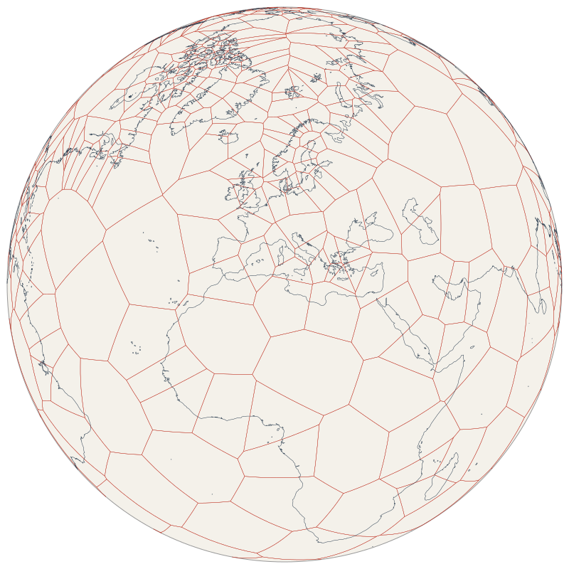

# hipparchus-rs

A Rust reimplementation of the Hipparchus geopositioning model devised by
Hrvoje Lukatela in the 1980s and sold commercially by Geodyssey Limited
(Calgary) from 1992. The model has three parts:

1. global positions represented as direction cosines of the surface normal, not
   latitude and longitude;
2. a data-density-driven partition of the Earth's surface into spherical
   Voronoi cells, used as the spatial index;
3. compact storage of coordinates as a cell identifier plus stereographic
   offsets from the cell centre.

The original library was distributed as a binary. Exclusive rights to it were
later sold to Microsoft, and Geodyssey has since been dissolved: this crate
is built from the published papers and the C code accompanying the 1992
*Dr. Dobb's Journal* article. See [DESIGN.md](DESIGN.md) for the design,
findings and roadmap.



## Status

Experimental (v0.1). The model is spherical only; Hipparchus proper worked on
the ellipsoid. Points are supported; line and region objects are not yet.

## What you can use this for

- **Store coordinates compactly.** `CellStructure::encode` stores a point as a
  cell identifier and two 32-bit offsets: 12 bytes, with an error below 1 mm
  in cells up to about 2,800 km in radius. See
  [`examples/nearby.rs`](examples/nearby.rs).
- **Index points by density.** `build::adaptive` splits cells until none holds
  more than a given number of points, so dense areas get small cells and open
  ocean gets large ones. See [`examples/nearby.rs`](examples/nearby.rs), and
  [`examples/coast.rs`](examples/coast.rs) for cell statistics and a drawing
  of the cells.
- **Find points near a place.** `CellStructure::cells_in_cap` returns the
  cells that a circle of a given radius can touch, so a query decodes only
  the points in those cells. See [`examples/nearby.rs`](examples/nearby.rs).
- **Triangulate points on the sphere.** `hull::sphere_delaunay_geo` gives the
  spherical Delaunay triangulation, and `CellStructure` gives each point's
  Voronoi neighbours and vertices, with no seams at the poles or the
  antimeridian. See [`examples/hull_bench.rs`](examples/hull_bench.rs) for
  timings, and the drawing in [`examples/coast.rs`](examples/coast.rs).

## Contents

| Module | Purpose |
|---|---|
| `algebra` | Port of the DDJ `ALGEBRA.C`: direction cosines, arc distance, stereographic frame. Pole singularity fixed. |
| `hull` | Spherical Delaunay triangulation. `sphere_delaunay_geo` (default) projects stereographically and uses `geo`'s spade-backed Delaunay; `sphere_delaunay` is an exact incremental 3D hull kept as the reference. |
| `cells` | Voronoi cell structure: circular neighbour lists, cell vertices and radii, home-cell walk, cap queries, 12-byte cell-local point encoding. |
| `build` | Adaptive structures: split any cell holding more than a given number of points. |
| `ddj` | Readers for the 1992 `COAST*.IDX` and `COAST.DAT` files. |

## Usage

```sh
cargo test --release
cargo run --release --example nearby       # store points, query near Dublin
cargo run --release --example coast        # statistics, writes cells.svg
cargo run --release --example hull_bench   # triangulation timings
```

```rust
use hipparchus_rs::{build, CellStructure, V3};

let cells = CellStructure::new(build::fibonacci(500)).unwrap();
let p = V3::from_lat_lon(53.34, -6.25);
let local = cells.encode(p, 0);   // { cell, e, n }
let back = cells.decode(local);
assert!(hipparchus_rs::arc(p, back) * hipparchus_rs::EARTH_RADIUS < 1e-3);
```

## Results on the 1992 coastline data

52,766 vertices; cells split above 256 vertices; 120 seed centres.

| Measure | Result |
|---|---|
| Cell structure | 366 cells in 8 rounds, 26 ms |
| Cell radius | 115 / 1,035 / 1,690 km (min / median / max) |
| Encode and decode all vertices | 7 ms; worst error 0.58 mm; 12 bytes per point |
| Home-cell walk | 0.03 steps per point from the previous vertex's cell; 7.7 from a fixed start |
| 500 km cap around Dublin | 9 cells; 2.9% of vertices read; all 662 true hits found |
| Original 1992 16-bit encoding | worst error 111 m against the ASCII source |
| Delaunay, 10⁶ random sites | 0.69 s (`geo` backend) |

The port agrees with the original C `MapStereo`, `UnMapStereo` and `ArcDist`
to 1e-12 on 2,000 cases, and reproduces its decoding of the first vertex of
each of the 992 dense coastline segments to 1e-12.

## References

Lukatela, H. (1987). Hipparchus geopositioning model: an overview. In
*Proceedings of Auto-Carto 8*, Baltimore, MD, March 1987. American Society for
Photogrammetry and Remote Sensing.
[PDF](https://cartogis.org/docs/proceedings/archive/auto-carto-8/pdf/hipparchus-geopositioning-model-an-overview.pdf)
(CaGIS Auto-Carto archive);
[HTML](https://geodyssey.neocities.org/papers/hlauto8).

Lukatela, H., & Russell, J. (1992). Spatial data and the Voronoi tessellation.
*Dr. Dobb's Journal*, December 1992.
[HTML](https://geodyssey.neocities.org/papers/dobbs92);
[companion code and data](http://nemo.asuscomm.com/orbis/geozips/dobbs92.zip).

Lukatela, H. (2000). A seamless global terrain model in the Hipparchus system.
Paper presented at the International Conference on Discrete Global Grids,
Santa Barbara, CA, 26–28 March 2000.
[HTML](http://lukatela.com/hrvoje/papers/ggterra.html).

Gilmore, R. V. (1992). *Hipparchus Tutorial*. Geodyssey Limited. Cited in
Lukatela & Russell (1992); a later edition is online as the
[Hipparchus Tutorial and Programmer's Guide](https://geodyssey.neocities.org/tutorial/tutorial.html).

Geodyssey Limited. Hipparchus
[library function reference](https://geodyssey.neocities.org/overview/functions)
and [utilities guide](https://geodyssey.neocities.org/utilities/utilities)
(archived documentation, 2004–2010); company
[archive site](https://geodyssey.github.io/).

Karney, C. F. F. (2013). Algorithms for geodesics. *Journal of Geodesy*,
87(1), 43–55. <https://doi.org/10.1007/s00190-012-0578-z>
(relevant to the planned ellipsoidal work; used by `geo`'s `Geodesic`).

## Licence

The code in this repository is licensed under the
[Blue Oak Model License 1.0.0](LICENSE.md).

The files in `tests/data` derived from the 1992 article are not covered by
that licence; see [tests/data/README.md](tests/data/README.md). This project is
not affiliated with Geodyssey Limited, Microsoft, or the authors of the papers
above. Hipparchus® was registered as a trademark by Geodyssey Limited.
